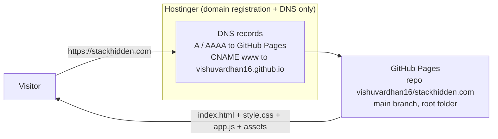
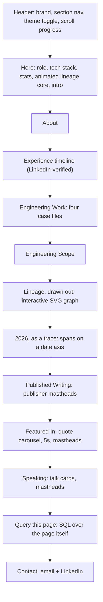
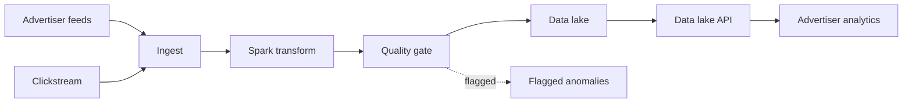

# stackhidden.com

Personal portfolio of Vishnuvardhan Reddy Kaithapuram, Software Development Engineer at Amazon Advertising, New York.

**Live site:** https://stackhidden.com
**Repository:** https://github.com/vishuvardhan16/stackhidden.com (this repo, and the only repo that serves the site)

The site is a hand-built static page: plain HTML, CSS, and JavaScript. No framework, no build step, no external scripts, fonts, CDNs, or trackers. What you see in this repo is exactly what the server sends.

---

## Project details

### What the site does

| Area | What it is |
| --- | --- |
| Hero | Name, current role (Software Development Engineer, Advertising Analytics and Insights at Amazon), his tech stack in his own words: Back-End Engineering, Java, APIs, Big Data. Live New York clock, the animated data hero figure, and the At a glance panel with the animated lineage core. The hero's lines rise into place once on load. |
| About | Short professional summary aligned with his LinkedIn profile. |
| Experience | Full verified timeline from LinkedIn: Amazon (Sep 2022 to present), Uptycs intern, TA Digital associate and intern, Augmented Byte intern. |
| Engineering Work | Four case files from his Amazon record: insight ingestion orchestration, the Insights API, custom brands (ICM) in the Insights Store, and the Mosaic and Kaleidoscope agents. Each opens in place and answers to a `#case=` deep link. |
| Lineage, drawn out | An interactive SVG lineage graph that draws itself along the data flow on first view. Hover, tap, or keyboard-focus a stage to trace its upstream and downstream edges. Send a clean or a bad record through it and watch the quality gate route the bad one to Flagged anomalies, with a pipeline log. Labelled on the page as an illustrative diagram. |
| 2026, as a trace | Seven 2026 spans (articles, a roundtable, a talk, and press quotes) on a Jul 1 to Dec 1 axis, each bar ending on its date. The bars render in date order on first view. Selecting a span shows its details. |
| Writing / Featured In | Three trade pieces and the site's build log, in date order, each under a publisher masthead with a logo slot. Featured In is a 5-second carousel of three expert-quote screenshots (two from Label Your Data, one from Informatics Magazine), each linked to the live article, with captions under the same masthead. |
| Speaking / Contact | Two cards under the same masthead: the Marketplace Risk New York 2026 talk, and the paper accepted at NICE-TEAS ASIA 2026. Contact by email (Gmail) or LinkedIn. |
| Query this page | A SQL console over eight tables built from the page's own HTML at load. Trace jumps from a result row to its source on the page; `#q=` links run a query on arrival. |

### Files

| File | Role |
| --- | --- |
| `index.html` | All content and structure. Architecture, content rules, and accessibility notes are documented in comments at the top of the file and on each section. |
| `style.css` | The dual light/dark theme system (CSS custom properties) and all layout. The theme system is documented in the stylesheet header. |
| `app.js` | Theme toggle (persisted), New York clock, background lineage canvas, trace case files, lineage explorer and send-a-record, quotes carousel, scrollspy and scroll progress, the query console (tables, lexer, parser, executor), and the first-view reveals. Each feature is documented where it lives. |
| `assets/favicon.svg` | The only brand mark. |
| `assets/quote-eu-ai-act.png`, `assets/quote-golden-dataset.png` | Screenshots of the published Label Your Data quote blocks, used in the Featured In carousel. |
| `assets/quote-informatics-access-privacy.png` | The quote card for the Informatics Magazine quote, made for this site in the same style. |
| `assets/quote-informatics-everyday-decisions.png` | The quote card for the second Informatics Magazine quote, made for this site in the same style. |
| `assets/quote-cto-sync-technical-debt.png` | The quote card for the CTO Sync quote, made for this site in the same style. |
| `assets/data-hero.webp`, `assets/data-hero-loop.mp4` | The hero figure: the still is the video's poster. |
| `assets/og-card.png` | The social share card. |
| `assets/logos/` | Official publisher logos, added by the owner. Not present until the first one is added; see `docs/publisher-logos.md`. |
| `CNAME` | The custom domain for GitHub Pages: `stackhidden.com`. |

### Content rules (owner's standing instructions)

1. No photo of Vishnu anywhere on the site, including in screenshots used on it and in social preview tags.
2. Every claim traces to a verified source: his LinkedIn profile read live, his published articles, or a real build artefact. Titles, dates, roles, and stacks are never invented.
3. Do not name the Journal of Big Data in any bio or profile text.
4. He is a Software Engineer. Never title him a Data Engineer.
5. The site presents his current role and record only. No future-role aspiration is stated anywhere on the site.

### Project structure

| Folder | What it holds |
| --- | --- |
| `assets/` | The site's images: the favicon, the data hero figure, the share card, the lineage core artwork, the three quote images, and (once added) publisher logos. |
| `tests/` | The automated test suite: one module per area, plus shared browser helpers. `docs/test-plan.md` says what each module protects. |
| `scripts/` | `run-tests.sh`, the one command that runs the whole suite locally. |
| `docs/` | The working documents, kept in the repo: how the site works, motion, the query console, publisher logos, the cursor bot, the lineage core, the content rules, deployment, testing, and the test plan. |
| `.github/workflows/` | The CI workflow (`site-checks`) that runs the same suite on every push and pull request. |

---

## Project design

### How the site is served



The domain registration stays at Hostinger because GitHub is not a domain registrar. Hosting, files, and HTTPS are entirely GitHub Pages. Enforce HTTPS is on; the certificate was issued on Oct 26, 2026.

### Page structure



### The lineage diagram's subject

The interactive graph on the page draws the pipeline architecture his writing describes:



### Theme design

Both themes are one layout driven by CSS custom properties (`--bg`, `--panel`, `--card`, `--text`, `--muted`, `--accent`, `--accent2`, `--border`). The toggle flips `data-theme` on the root element and persists the choice in `localStorage`; a small inline script in the document head applies the saved theme before first paint so there is no flash of the wrong theme. The background canvas reads the same theme and re-palettes itself.

---

## How to test

### Running the checks

```bash
scripts/run-tests.sh
```

One command runs the automated suite: the static content-rule checks first, then the browser modules against the local files (theme, palette, case files, carousel, explorer, layout, motion, regressions, query console, records, animations, and publishers; `docs/test-plan.md` says what each protects), with a pass/fail line per module and a non-zero exit if anything fails. The browser modules need Playwright; the script uses the venv at `/tmp/pwenv` when it is present, and python3 otherwise. CI (`.github/workflows/ci.yml`) runs the same suite on every push and pull request, against the site served locally in the runner.

### Run it locally

```bash
cd stackhidden.com              # this repo, cloned
python3 -m http.server 8000     # then open http://localhost:8000
```

No build step. Editing a file and refreshing the browser is the whole loop.

### Pre-push checklist (every item must pass)

1. **HTML structure.** Parse `index.html` (for example with Python's `html.parser`): zero errors, nothing unclosed, exactly one `h1`, landmarks present (`header`, `nav`, `main`, `footer`), every section has a heading.
2. **JavaScript syntax.** `node --check app.js` passes.
3. **Structured data.** The JSON-LD block in the head parses as valid JSON.
4. **Assets resolve.** Serve locally and confirm `index.html`, `style.css`, `app.js`, `assets/favicon.svg`, all three quote images, and any publisher logos return HTTP 200.
5. **No photo.** `grep -ri "profile.jpg" .` over the site files returns nothing, and no image of the owner exists in `assets/`.
6. **No forbidden wording.** `grep -ri "journal of big data" index.html` returns nothing; `grep -c "Senior" index.html` is 0; his title is never written as Data Engineer.
7. **Links.** Every external link is `https://` and has been opened and verified live (the three trade pieces, both Label Your Data articles, the Informatics Magazine Q&A, both speaking links, LinkedIn).
8. **Both themes.** Load the page, toggle light and dark: layout identical, all text readable in both, the secondary (outline) button label clearly visible in dark mode, the canvas and the lineage graph recolour.
9. **Widths.** Check at 360px, 480px, 768px, and desktop: no horizontal scrolling at any width (`document.documentElement.scrollWidth` equals the viewport width).
10. **Motion.** With `prefers-reduced-motion` on, and again with the footer's Reduce motion: the canvases are still, the hero intro does not play, the trace and graph are drawn in place, and the carousel does not auto-advance. With it off: the carousel advances every 5 seconds, moving left to right, and pauses on hover and on keyboard focus. `docs/motion.md` lists every moving piece.
11. **Keyboard.** Tab through the page: theme toggle, lineage stages, the send-a-record buttons, trace rows, carousel arrows and dots, and the query console (editor, Run, examples, Trace buttons) are all reachable and operable with Enter or Space.
12. **Accessibility audit.** For a visual change, run axe-core over the changed sections in both themes. It must report no violations.

### Verify the live site after a push

```bash
curl -s -o /dev/null -w "%{http_code} %{size_download}\n" https://stackhidden.com/
curl -s https://stackhidden.com/ | grep -c "For opportunities or questions about my work"
curl -s -o /dev/null -w "%{http_code}\n" https://stackhidden.com/assets/profile.jpg   # must be 404
curl -s https://api.github.com/repos/vishuvardhan16/stackhidden.com/commits?per_page=5
```

GitHub Pages usually rebuilds within a minute or two of a push. The repo's Actions tab shows two runs per push, `site-checks` (the test suite) and `pages build and deployment`; both must succeed. The bare domain can be served from cache for a few minutes after a deploy, so if it looks stale, check `https://stackhidden.com/index.html` before changing anything.

---

## Deployment and repository rules

- **Scope rule (owner):** work happens in this repository only. No other repository of his is opened or changed for this project.
- **Commit convention:** small, separate, detailed commits. Every commit has a summary line with a type, optionally scoped (`feat:`, `fix:`, `docs:`, `test:`, `refactor:`, `ci:`, `chore:`, `revert:`; for example `fix(copy):`), and a description that says what changed, why, and how it was verified. Squashed or vague commits are not acceptable on this project.
- **Access:** the owner is the only collaborator. Repository interaction limits are set so non-collaborators cannot open issues or pull requests. The code is public because GitHub Pages on this plan serves public repositories; that visibility does not grant anyone write access, and nothing merges without the owner. Claude sessions push through the Claude GitHub App, installed on this repository only; Claude is not a collaborator (see `docs/deployment.md`).
- **DNS (at Hostinger, set Oct 26, 2026, all TTL 14400):** A `@` to 185.199.108.153, 185.199.109.153, 185.199.110.153, 185.199.111.153; AAAA `@` to 2606:50c0:8000::153 through 8003::153; CNAME `www` to `vishuvardhan16.github.io`. MX (Titan Email) and TXT (SPF, DKIM) records are unrelated to the site and must not be touched.
- **Domain renewal:** the registration renews at Hostinger on Nov 1, 2026 ($20.19 plus tax); the domain expires Nov 28, 2026 if not renewed. Do not cancel the registration: the live site depends on it.

## V4 (October 2026)

Design pass driven by a study of the best engineer portfolios (Jared
Chester's site in particular). What changed:

- **Case files** in Engineering Work now follow a fixed template:
  lede, impact row, the problem, what I built, named **Decisions**,
  and a stack line. Content is from the owner's own Amazon record.
  Each file expands in place and answers to a deep link
  (`#case=icm`, `#case=mosaic`, and so on).
- **Command palette**: Ctrl or Cmd + K (or the header button) opens a
  filterable command list: section jumps, opening case files, copy
  email, print, theme, and motion controls.
- **Pointer, scroll, and click graphics**: a soft glow trails the
  cursor (fine pointers only), a ring-and-sparks burst fires on
  background clicks, and sections reveal as they scroll into view.
- **Print resume mode**: `@media print` flattens the page to a clean
  document with every case file open and all interactive layers off.
- **Reduce motion control** in the footer mirrors
  `prefers-reduced-motion` and persists per visitor.
- Stats are sentence fragments with the numbers up front, each 2026
  trace row carries its result, and Writing gained a short build log,
  "How This Site Works."

Extra pre-push checks for v4: open and close each case file, follow a
`#case=` link, run two palette commands by keyboard, click the page
background for the burst, toggle Reduce motion and confirm the canvas
and packets stop, and print-preview to confirm case files print open.

## V5 (November 2026)

Two features a visitor does, not more motion that plays on its own,
plus fixes for bugs that had shipped silently.

- **Query this page.** A SQL console (SELECT with WHERE, GROUP BY,
  ORDER BY, LIMIT, DISTINCT, aggregates, and a few functions, plus
  SHOW TABLES, DESCRIBE, HELP) over eight tables built from the page's
  HTML at load. Every run shows its plan. Trace jumps from a row to its
  source element. Tab completes names, errors suggest the nearest
  table or column, and the query lives in the URL as `#q=` (via
  replaceState, after Datasette, so Back is never trapped). The Cmd+K
  palette runs SQL typed into it.
- **Send a record.** Clean and bad records travel the lineage graph; the
  gate holds the bad one in Flagged anomalies, and a log records every
  stage.
- **Fixes.** The background canvas painted nothing until a resize (a
  shared `var nodes` in app.js), and hovering the explorer threw after a
  resize. Scrollspy matched no links, and Contact could never light up.
  The footer Reduce motion control did not stop the carousel, and the
  hero core stayed frozen after motion was turned back on. Each toggle
  stacked another canvas loop. The hero video border used an undefined
  variable. The amber packet flowed into the data lake.
- **Phones.** The header went from 146px to 90px tall (links scroll in
  one row), and the lineage graph keeps legible labels and scrolls
  sideways.
- **Tests.** Three new modules: `test_regressions` (each test failed on
  the pre-v5 code first), `test_query`, and `test_records`. The suite
  is 11 modules, 49 tests.

Extra pre-push checks for v5: run two example queries and a typo, Trace
a featured quote, open a `#q=` link, send one clean and one bad record,
and check the header and lineage graph at 360px.

## V5, second pass (November 2026)

- **Motion.** Three one-shot animations, each skipped under reduced motion and each cleaning up after itself: the hero intro (the page's one load moment), the 2026 trace rendering its bars in date order, and the lineage graph drawing itself along the data flow. The head script now applies a stored Reduce motion choice before first paint. `docs/motion.md` is an inventory of every moving piece.
- **Trace accuracy.** The 2026 bars now end on their real dates on a Jul 1 to Dec 1 axis, with month notches. Before, Oct 23 and Nov 2 both drew at 100%.
- **Publisher mastheads.** Published Writing, Speaking (now two cards), and the Featured In captions open with the publisher's name, a kind pill, and the date, plus a slot for official logos the owner adds (`docs/publisher-logos.md`). Links in a row of cards now share a baseline.
- **Carousel fit.** The quote carousel sizes itself to its slides. On phones, captions used to run about 50px under the arrows and dots.
- **Copy.** Grammar and spelling fixes (American English throughout), Published Writing in date order, the trace note and the Marketplace Risk superlative made accurate, and an updated build log card.
- **Tests.** Two new modules, `test_animations` and `test_publishers`. The suite is 13 modules, 65 tests.

Extra pre-push checks for this pass: load the page and watch the hero intro once; scroll to the trace and the graph and watch each reveal; turn Reduce motion on and confirm none of them play; check the Featured carousel at 360px.

## License and artwork

The site's code is released under the MIT License (see `LICENSE`),
copyright Vishnuvardhan Reddy Kaithapuram. The license covers the
code only; the words, record, and published material on the page are
the owner's own.

The hero artwork (`assets/lineage-core-dark.png` and
`assets/lineage-core-light.png`) was generated for this site: a
halftone core with orbiting graph nodes, drawn from the owner's
lineage work. One version per theme; CSS shows the matching one.
Contact is links only (Email me, LinkedIn) by the owner's direction;
the print stylesheet remains so a visitor's own print stays clean.
