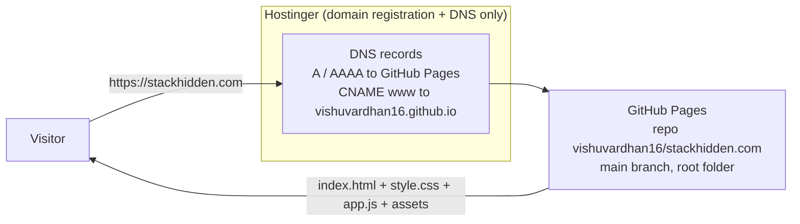
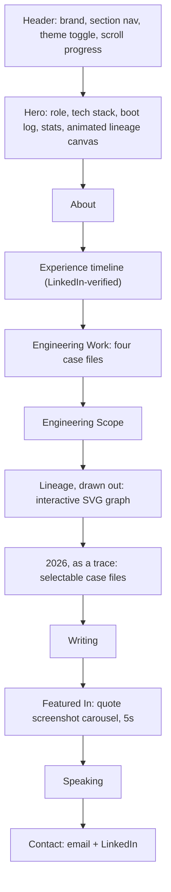
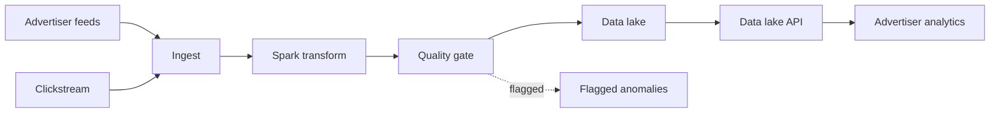

# stackhidden.com

Personal portfolio of Vishnuvardhan Reddy Kaithapuram, Software Development Engineer at Amazon Advertising, New York.

**Live site:** https://stackhidden.com
**Repository:** https://github.com/vishuvardhan16/stackhidden.com (this repo, and the only repo that serves the site)

The site is a hand-built static page: plain HTML, CSS, and JavaScript. No framework, no build step, no external scripts, fonts, CDNs, or trackers. What you see in this repo is exactly what the server sends.

---

## Project details

### What the site does

| Area | What it is |
| --- | --- |
| Hero | Name, current role (Software Development Engineer, Advertising Analytics and Insights at Amazon), his tech stack in his own words: Back-End Engineering, Java, APIs, Big Data. Live New York clock and a one-line boot log. |
| About | Short professional summary aligned with his LinkedIn profile. |
| Experience | Full verified timeline from LinkedIn: Amazon (Sep 2022 to present), Uptycs intern, TA Digital associate and intern, Augmented Byte intern. |
| Engineering Work | Four case files: data quality at petabyte scale, advertiser analytics after identifiers, the LedgerLens payment anomaly agent, and graph-based lineage research. |
| Lineage, drawn out | An interactive SVG lineage graph. Hover, tap, or keyboard-focus a stage to trace its upstream and downstream edges. Labelled on the page as an illustrative diagram. |
| 2026, as a trace | His 2026 publications and talk as tracing spans. Selecting a span opens its case file. |
| Writing / Featured In | Three trade articles with exact titles and dates, and a 5-second auto-advancing carousel of screenshots of his two Label Your Data expert quotes, each linked to the live article. |
| Speaking / Contact | Marketplace Risk New York 2026, and contact by email (Gmail) or LinkedIn. |

### Files

| File | Role |
| --- | --- |
| `index.html` | All content and structure. Architecture, content rules, and accessibility notes are documented in comments at the top of the file and on each section. |
| `style.css` | The dual light/dark theme system (CSS custom properties) and all layout. The theme system is documented in the stylesheet header. |
| `app.js` | Theme toggle (persisted), New York clock, background lineage canvas, boot log typing, trace case files, lineage explorer, quotes carousel, scrollspy and scroll progress. Each feature is documented where it lives. |
| `assets/favicon.svg` | The only brand mark. |
| `assets/quote-eu-ai-act.png`, `assets/quote-golden-dataset.png` | Screenshots of the published Label Your Data quote blocks, used in the Featured In carousel. |
| `CNAME` | The custom domain for GitHub Pages: `stackhidden.com`. |

### Content rules (owner's standing instructions)

1. No photo of Vishnu anywhere on the site, including in screenshots used on it and in social preview tags.
2. Every claim traces to a verified source: his LinkedIn profile read live, his published articles, or a real build artefact. Titles, dates, roles, and stacks are never invented.
3. Do not name the Journal of Big Data in any bio or profile text.
4. He is a Software Engineer. Never title him a Data Engineer.
5. The site presents his current role and record only. No future-role aspiration is stated anywhere on the site.

---

## Project design

### How the site is served



The domain registration stays at Hostinger because GitHub is not a domain registrar. Hosting, files, and HTTPS are entirely GitHub Pages. Enforce HTTPS is on; the certificate was issued on Oct 26, 2026.

### Page structure



### The lineage diagram's subject

The interactive graph on the page draws the pipeline architecture his writing describes:



### Theme design

Both themes are one layout driven by CSS custom properties (`--bg`, `--panel`, `--card`, `--text`, `--muted`, `--accent`, `--accent2`, `--border`). The toggle flips `data-theme` on the root element and persists the choice in `localStorage`; a small inline script in the document head applies the saved theme before first paint so there is no flash of the wrong theme. The background canvas reads the same theme and re-palettes itself.

---

## How to test

### Run it locally

```bash
cd portfolio-stackhidden        # this repo, cloned
python3 -m http.server 8000     # then open http://localhost:8000
```

No build step. Editing a file and refreshing the browser is the whole loop.

### Pre-push checklist (every item must pass)

1. **HTML structure.** Parse `index.html` (for example with Python's `html.parser`): zero errors, nothing unclosed, exactly one `h1`, landmarks present (`header`, `nav`, `main`, `footer`), every section has a heading.
2. **JavaScript syntax.** `node --check app.js` passes.
3. **Structured data.** The JSON-LD block in the head parses as valid JSON.
4. **Assets resolve.** Serve locally and confirm `index.html`, `style.css`, `app.js`, `assets/favicon.svg`, and both quote screenshots return HTTP 200.
5. **No photo.** `grep -ri "profile.jpg" .` over the site files returns nothing, and no image of the owner exists in `assets/`.
6. **No forbidden wording.** `grep -ri "journal of big data" index.html` returns nothing; `grep -c "Senior" index.html` is 0; his title is never written as Data Engineer.
7. **Links.** Every external link is `https://` and has been opened and verified live (both Label Your Data articles, LinkedIn).
8. **Both themes.** Load the page, toggle light and dark: layout identical, all text readable in both, the secondary (outline) button label clearly visible in dark mode, the canvas and the lineage graph recolour.
9. **Widths.** Check at 360px, 480px, 768px, and desktop: no horizontal scrolling at any width (`document.documentElement.scrollWidth` equals the viewport width).
10. **Motion.** With `prefers-reduced-motion` on: the canvas is static, the boot log does not type, the carousel does not auto-advance. With it off: the carousel advances every 5 seconds, moving left to right, and pauses on hover and on keyboard focus.
11. **Keyboard.** Tab through the page: theme toggle, lineage stages, trace rows, carousel arrows and dots are all reachable and operable with Enter or Space.

### Verify the live site after a push

```bash
curl -s -o /dev/null -w "%{http_code} %{size_download}\n" https://stackhidden.com/
curl -s https://stackhidden.com/ | grep -c "For opportunities or questions about my work"
curl -s -o /dev/null -w "%{http_code}\n" https://stackhidden.com/assets/profile.jpg   # must be 404
curl -s https://api.github.com/repos/vishuvardhan16/stackhidden.com/commits?per_page=5
```

GitHub Pages usually rebuilds within a minute or two of a push. If the live page looks stale, check the newest commit first, then wait and re-run the checks before changing anything.

---

## Deployment and repository rules

- **Scope rule (owner):** work happens in this repository only. No other repository of his is opened or changed for this project.
- **Commit convention:** small, separate, detailed commits. Every commit has a summary line (`feat:`, `fix:`, `docs:`, `chore:`) and a description that says what changed, why, and how it was verified. Squashed or vague commits are not acceptable on this project.
- **Access:** the owner is the only collaborator. Repository interaction limits are set so non-collaborators cannot open issues or pull requests. The code is public because GitHub Pages on this plan serves public repositories; that visibility does not grant anyone write access, and nothing merges without the owner.
- **DNS (at Hostinger, set Oct 26, 2026, all TTL 14400):** A `@` to 185.199.108.153, 185.199.109.153, 185.199.110.153, 185.199.111.153; AAAA `@` to 2606:50c0:8000::153 through 8003::153; CNAME `www` to `vishuvardhan16.github.io`. MX (Titan Email) and TXT (SPF, DKIM) records are unrelated to the site and must not be touched.
- **Domain renewal:** the registration renews at Hostinger on Nov 1, 2026 ($20.19 plus tax); the domain expires Nov 28, 2026 if not renewed. Do not cancel the registration: the live site depends on it.

## V4 (October 2026)

Design pass driven by a study of the best engineer portfolios (Jared
Chester's site in particular). What changed:

- **Case files** in Engineering Work now follow a fixed template:
  lede, impact row, the problem, what I built, named **Decisions**,
  and a stack line. Content is from the owner's own Amazon record.
  Each file expands in place and answers to a deep link
  (`#case=icm`, `#case=mosaic`, and so on).
- **Command palette**: Ctrl or Cmd + K (or the header button) opens a
  filterable command list: section jumps, opening case files, copy
  email, print, theme, and motion controls.
- **Pointer, scroll, and click graphics**: a soft glow trails the
  cursor (fine pointers only), a ring-and-sparks burst fires on
  background clicks, and sections reveal as they scroll into view.
- **Print resume mode**: `@media print` flattens the page to a clean
  document with every case file open and all interactive layers off.
- **Reduce motion control** in the footer mirrors
  `prefers-reduced-motion` and persists per visitor.
- Stats are sentence fragments with the numbers up front, each 2026
  trace row carries its result, and Writing gained a short build log,
  "How This Site Works."

Extra pre-push checks for v4: open and close each case file, follow a
`#case=` link, run two palette commands by keyboard, click the page
background for the burst, toggle Reduce motion and confirm the canvas
and packets stop, and print-preview to confirm case files print open.

## License and artwork

The site's code is released under the MIT License (see `LICENSE`),
copyright Vishnuvardhan Reddy Kaithapuram. The license covers the
code only; the words, record, and published material on the page are
the owner's own.

The hero artwork (`assets/lineage-core-dark.png` and
`assets/lineage-core-light.png`) was generated for this site: a
halftone core with orbiting graph nodes, drawn from the owner's
lineage work. One version per theme; CSS shows the matching one.
Contact is links only (Email me, LinkedIn) by the owner's direction;
the print stylesheet remains so a visitor's own print stays clean.
